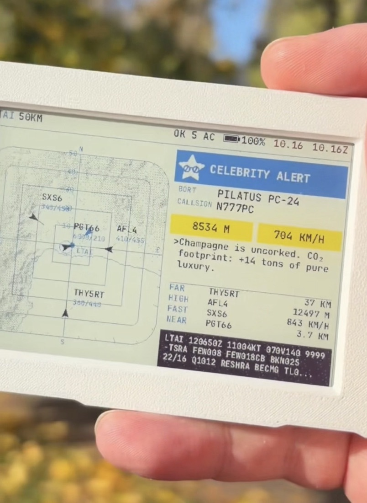

# Sarcastic Radar

A pocket radar for the sky above your head. Pulls live ADS-B traffic, the local
METAR and a shaded relief map, then dithers the whole thing onto a 4" six-colour
e-paper panel with a commentary problem.

Hardware: M5Stack M5PaperColor (C151), ESP32-S3, 600×400 Spectra 6 panel.



Here it is judging a business jet that has done nothing to deserve it.

## Before you flash

You need:

* an M5PaperColor and a USB-C **data** cable (the charge-only ones are a scam and
  will waste your evening)
* Arduino IDE 2.x, or `arduino-cli` if you like living in the terminal
* the **M5Stack** board package, board name `M5PaperColor`. It is not in the
  stock board list — you have to feed the Board Manager this URL first:
  `https://static-cdn.m5stack.com/resource/arduino/package_m5stack_index.json`
* two libraries: **M5Unified** and **ArduinoJson** (M5GFX rides along with
  M5Unified, nothing else to install)

Tested with esp32 core 3.3.9, M5Unified 0.2.23, M5GFX 0.2.30, ArduinoJson 7.4.3.
Newer stuff will probably behave. Older stuff, no promises.

## Flash it

Arduino IDE:

1. Boards Manager → install the M5Stack package → pick **M5PaperColor**.
2. Library Manager → install **M5Unified** and **ArduinoJson**.
3. Open `sarcastic_radar.ino`, plug the board in, select the port that looks like
   `usbmodem…`, hit **Upload**.
4. Done. Watch the serial monitor at 115200 baud if you want to see it think.

Terminal people:

```sh
arduino-cli core install m5stack:esp32 \
  --additional-urls https://static-cdn.m5stack.com/resource/arduino/package_m5stack_index.json
arduino-cli lib install M5Unified ArduinoJson
arduino-cli compile -b m5stack:esp32:m5stack_papercolor .
arduino-cli upload -b m5stack:esp32:m5stack_papercolor -p /dev/cu.usbmodemXXXX .
```

Once the core is in, `arduino-cli board listall | grep -i papercolor` should
show `M5PaperColor m5stack:esp32:m5stack_papercolor`. If it does not, the index
URL never got through and you are just guessing at board names.

No port in the list? Nine times out of ten it is the cable. Upload dies halfway?
Unplug, plug back in, retry — the board is not bricked, it just sulks.

## First boot

A fresh board knows nothing, so it boots straight into setup:

* it raises its own access point, `SarcasticRadar-XXXX`
* the password is random every boot, and the screen shows both the password and
  a QR code — point your phone camera at it and you are in
* the setup page opens by itself; if it does not, type `http://192.168.4.1`

On that page you set:

* Wi-Fi network and password — leave the password blank to keep the saved one
* latitude and longitude of the spot you want to watch
* radius: 50 or 100 km
* time zone, in hours offset from UTC (halves are fine)
* METAR station, 4-letter ICAO code — optional, it is the weather strip at the
  bottom

Hit save, the thing reboots, and a couple of minutes later the radar shows up.
Settings live in NVS on the device; nothing personal ends up in this repo.

## Power

Tap the **PWR** key and the board wakes up. That key goes straight into the
PMIC, not the CPU, so the firmware has nothing to do with switching on — the
chip just gets power and boots. The panel keeps showing whatever was there
before, which is normal for e-paper and not a sign of life either way.

Give it a minute or so before the first frame lands: Wi-Fi, weather, terrain,
then half a minute of the panel chewing on the image. The two LEDs pulse a
blue heartbeat meanwhile — and only then, plus while a frame is being painted
and in red while the thing is going down. Off the rest of the time on purpose,
so no glow to confuse with a status.

To switch off, hold **B** for ~1.5 s — it waves goodbye, parks the panel and
cuts the power. Holding **PWR** for ~1.5 s does the same without the farewell
screen. Past two seconds the PMIC's own cutoff fires and you get the same
result, so do not sit on the button wondering.

## Buttons

The panel is e-paper, so a frame takes around half a minute to grind out.
Staring at a frozen screen while it thinks is normal. Do not panic.

| Button | Action |
| --- | --- |
| **A**, tap | Dump the current frame and go grab fresh data right now |
| **A + B**, hold ~1.5 s | Open setup mode — access point, QR, the works |
| **A** or **C**, hold in setup | Bail out of setup mode and reboot |
| **B**, hold ~1.5 s | Say goodbye, put the panel to sleep, cut the power |
| **C** | Nothing outside setup mode — it is the escape hatch, not a gadget |
| **PWR**, tap when off | Wake the thing up |
| **PWR**, hold ~1.5 s | Cut the power instantly, no farewell screen |

Left alone, it refreshes itself every two minutes.

## The case

`sarcasticradar1.stl` and `sarcasticradar2.stl` in `enclosure/` — the frame with
the window and the back shell, 74.4 × 117.4 × 6.2 mm each, both thin shells
sized around the board. Print both and sandwich the board between them; that is
not difficult, and it beats leaving it naked on a shelf.

## Watch it move

An e-paper repaint refuses to photograph well, so there is a video of a whole
frame grinding out: [@aamuilmacraft on Instagram](https://instagram.com/aamuilmacraft).

## Version one, and honest about it

This is v1: it boots, it draws, it shuts up when told. No settings menu worth
the name, no themes, no weather radar overlay, no personality knobs. It does
one thing and it does it on a screen that takes half a minute to agree.

If people actually build it, star it, or send the sort of angry issue that
suggests somebody cares, it keeps growing — more screens, fewer rough edges,
possibly a feature you will regret asking for. If the repo stays quiet, so be
it: this is a personal project that already does what I wanted it to do, and
I am perfectly capable of enjoying my own radar in silence.

Either way, issues and sane pull requests are welcome. Insults about the
dithering will be taken as feedback.
